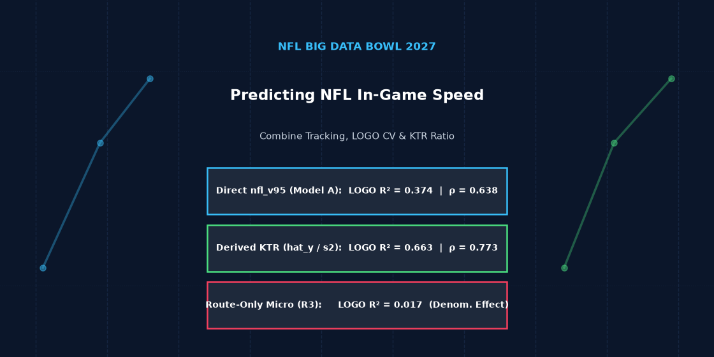
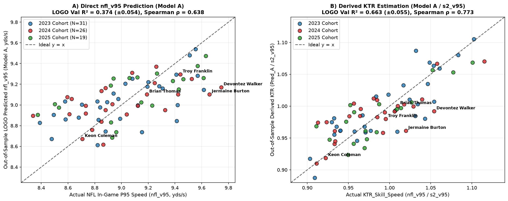
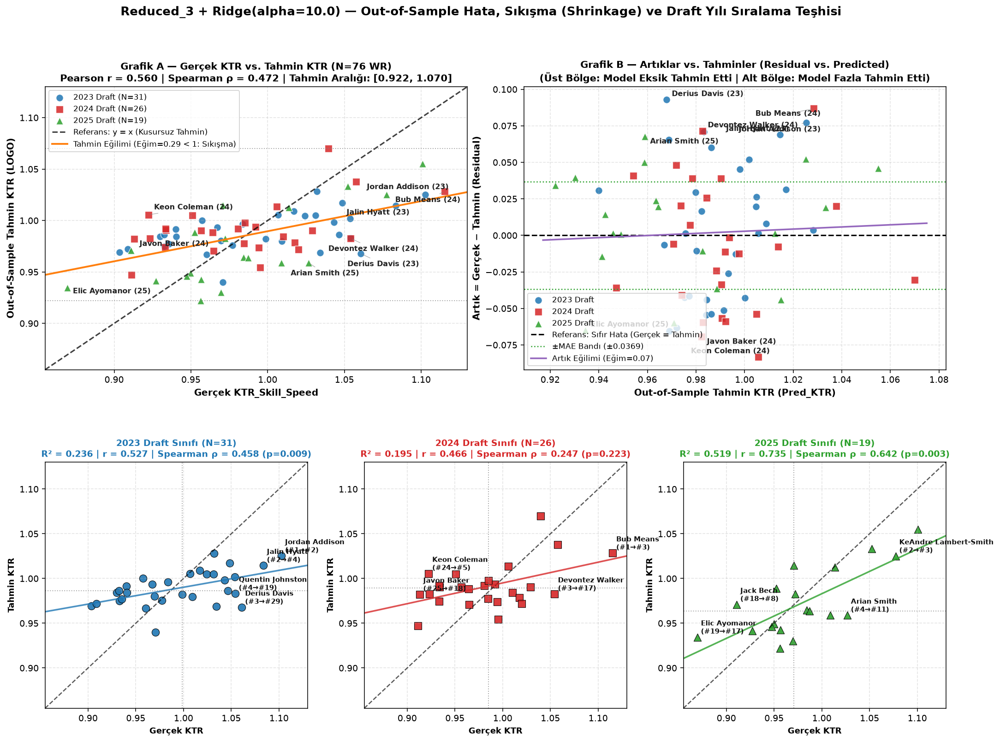

# 🏈 NFL Big Data Bowl 2027 — Predicting NFL In-Game Speed (`nfl_v95`) from Combine Tracking Data



> **Target Formulation, Leak-Free Leave-One-Draft-Year-Out (LOGO) Validation, and the Role of Micro-Biomechanical Features for Wide Receivers (2023–2025 Cohorts, N = 76)**

---

## 📌 Project Overview

At the NFL Scouting Combine, Wide Receiver (WR) prospects are evaluated both in linear speed drills (the 40-yard dash) and in position-specific route drills (*gauntlet*, *slant*, *out*, *corner*, *post*, *go*) using 10 Hz player-tracking sensors. This repository investigates how pre-draft Combine measurements translate to regular-season NFL in-game speed (`nfl_v95`) and examines the mathematical structure of ratio targets (*Kinematic Translation Ratio — KTR*).

### Core Research Questions
1. **Direct In-Game Speed Prediction:** To what extent can pre-draft Combine measurements predict a WR prospect's regular-season 95th-percentile in-game speed (`nfl_v95`) across unseen draft cohorts (`2023`, `2024`, `2025`)?
2. **Incremental Value of Route Micro-Features:** Do Combine route-drill tracking features (`hb_v95`, `deep_v95`, `hb_cut_speed_retention`) and extended sensor speed/acceleration metrics (`s1_v95`, `s2_vmax`, `forty_a95`, `s2_a95`) provide consistent out-of-sample gains over a parsimonious baseline of linear speed and anthropometrics?
3. **Target Formulation (Ratio vs. Numerator Modeling):** When modeling `KTR_Skill_Speed = nfl_v95 / s2_v95`, how much predictive performance stems from learning in-game speed (`nfl_v95`) versus leveraging the known pre-draft Combine denominator (`s2_v95`)?

---

## 📊 Key Empirical Findings

### 1. Direct `nfl_v95` Prediction (Leave-One-Draft-Year-Out Validation)

| Model (`Ridge, alpha=10.0`) | Features | LOGO Train R² | **LOGO Val R² (± Std)** | LOGO Gap | **LOGO RMSE** | **LOGO Spearman ρ** | Top-25% Capture | 2023 R² (ρ) | 2024 R² (ρ) | 2025 R² (ρ) |
| :--- | :---: | :---: | :---: | :---: | :---: | :---: | :---: | :---: | :---: | :---: |
| **Micro Only (`Reduced_3`)** | 3 | 0.118 | **0.017** (± 0.049) | 0.101 | 0.3473 | **0.227** | 31.6% | -0.023 (0.12) | 0.087 (0.37) | -0.012 (0.27) |
| **Model A — Baseline (`Classical Full`)** | **4** | 0.451 | **0.374** (± 0.054) | **0.077** | 0.2771 | **0.638** | 57.9% | **0.424 (0.62)** | 0.299 (0.62) | 0.399 (0.68) |
| **Model B — Combined (`A + Reduced_3`)** | 7 | 0.512 | **0.386** (± 0.072) | 0.126 | 0.2765 | **0.676** | 57.9% | 0.354 (0.61) | 0.319 (0.69) | **0.486 (0.78)** |
| **Model C3 — Extended (`Vel. + Accel.`)** | 8 | 0.513 | **0.392** (± 0.026) | 0.121 | **0.2727** | **0.683** | **63.2%** | **0.427 (0.66)** | **0.366 (0.66)** | 0.382 (0.75) |

* **Parsimony vs. Complexity:** Standalone route micro-features (`Reduced_3`) do not predict `nfl_v95` (`LOGO R² = 0.017`). While **`Model C3`** achieves the highest raw LOGO validation score (`R² = 0.392, ρ = 0.683`), **`Model A`** (`forty`, `forty_vmax`, `combine_height`, `combine_weight`) is selected as the primary baseline due to its parsimony (4 features) and smallest Train–Validation gap (`0.077` vs. `0.121–0.126`).

---

### 2. Denominator Coupling in `KTR_Skill_Speed` and the Derived Ratio Approach

| KTR Estimation Strategy | Numerator (`nfl_v95`) LOGO R² | **KTR LOGO Val R² (± Std)** | **KTR LOGO RMSE** | **KTR LOGO Spearman ρ** | 2023 KTR R² (ρ) | 2024 KTR R² (ρ) | 2025 KTR R² (ρ) |
| :--- | :---: | :---: | :---: | :---: | :---: | :---: | :---: |
| **0. Constant-Mean Numerator Ref.** (`mean_train_nfl / s2_v95`) | -0.010 | **0.459** (± 0.033) | 0.0385 | **0.620** | 0.483 (0.66) | 0.412 (0.47) | 0.481 (0.62) |
| **1. Direct KTR Regression — `Reduced_3`** | 0.017 | **0.317** (± 0.144) | 0.0438 | 0.472 | 0.236 (0.46) | 0.195 (0.25) | 0.519 (0.64) |
| **2. Derived KTR (`Predicted_nfl_v95 / s2_v95`) — `Model A`** | **0.374** | **0.663** (± 0.055) | **0.0303** | **0.773** | **0.702 (0.80)** | **0.586 (0.67)** | **0.702 (0.75)** |
| **3. Derived KTR (`Predicted_nfl_v95 / s2_v95`) — `Model C3`** | **0.392** | **0.673** (± 0.034) | **0.0299** | **0.800** | 0.692 (0.79) | **0.626 (0.72)** | **0.702 (0.80)** |



---

### 3. Cohort & Player-Level Error Diagnostics (2023–2025)



* **High-Volume Starters (`≥ 200` tracked plays, N = 56):** `Model A` achieves `OOF R² = 0.428` (`RMSE = 0.2317 yds/s`, `MAE = 0.1915 yds/s`), accurately calibrating 2024 starters such as **Keon Coleman** (`+0.035 yds/s` error), **Brian Thomas** (`+0.088 yds/s`), and **Troy Franklin** (`+0.144 yds/s`).
* **Low-Snap Receivers (`< 200` tracked plays, N = 20):** Higher residuals occur in low-volume players such as **Devontez Walker** (80 plays, `+0.575 yds/s`) and **Jermaine Burton** (96 plays, `+0.554 yds/s`), where `OOF RMSE = 0.3605 yds/s`. This pattern is discussed as an explanatory hypothesis related to sampling variance or situational deployment.

---

## 📁 Repository Structure

```text
NFL_Big_Data_Bowl/
├── README.md                          # Project overview, key tables, and visual summary
├── KAGGLE_FINAL_REPORT.md             # Complete 8-section Kaggle Competition Writeup report
├── kaggle_final_submission.ipynb      # Streamlined 9-cell reproducible submission notebook
├── arda_main.ipynb                    # Primary analysis notebook (synchronized with final submission)
├── arda_main_full_archive.ipynb       # Complete 24-cell exploratory research archive
├── irem_main.ipynb                    # Team exploratory notebook
└── data_cache/
    ├── wr_predraft_micro_master.parquet          # Processed pre-draft Combine + NFL target dataset (N = 76 WRs)
    └── figures/
        ├── kaggle_card_thumbnail_560x280.png     # Project card & thumbnail banner
        ├── kaggle_final_2panel_summary.png       # Direct nfl_v95 & Derived KTR 2-panel summary plot
        ├── ktr_reduced3_error_diagnostics.png    # 2023–2025 cohort error & residual diagnostic plot
        ├── wr_classical_vs_our_model_accuracy.png# Model family comparison summary
        └── nfl_bdb2027_project_video.mp4         # 45-second 1080p animated presentation video
```

---

## 🚀 Quickstart

```bash
pip install numpy pandas scipy scikit-learn matplotlib pyarrow jupyter
jupyter notebook kaggle_final_submission.ipynb
```
